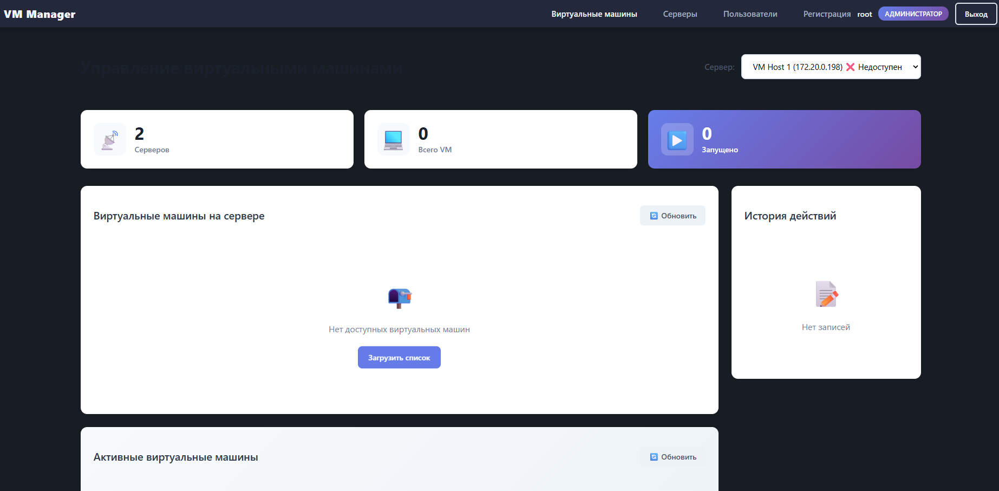

# VM Manager — платформа управления облачными виртуальными машинами

Fullstack-система для предоставления и удалённого управления виртуальными машинами на базе KVM. Проект объединяет серверную инфраструктуру виртуализации, API управления ресурсами и пользовательский веб-интерфейс.

### Основные возможности

- Управление виртуальными машинами через KVM/libvirt.
- Подключение к удалённым серверам через SSH-туннели и Jump Host.
- Управление виртуальной инфраструктурой через REST API.
- Авторизация пользователей и разграничение прав доступа.
- Мониторинг доступности серверов.
- Интеграция с механизмами удалённого подключения и передачи видеопотока.

### Технологический стек

**Backend:** Python, FastAPI, PostgreSQL, SQLAlchemy, Alembic, libvirt, JWT.

**Frontend:** Vue 3, Quasar, JavaScript, Axios.

**Инфраструктура:** KVM, SSH, Linux

### Мой вклад

Самостоятельно спроектировал и реализовал backend и frontend приложения: разработал API и серверную бизнес-логику, интеграцию с гипервизором KVM через libvirt, механизмы подключения к удалённым серверам, авторизацию и пользовательский веб-интерфейс.

## Скриншоты

